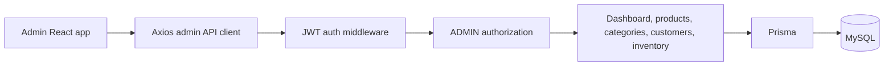

# Admin dashboard architecture

The admin app uses the existing JWT access-token and HTTP-only refresh-cookie
flow. All management endpoints are mounted under `/api/v1/admin`, then pass
through `authenticate` and `authorize('ADMIN')` before reaching a controller.

The implemented dashboard is limited to data represented by the current
schema. Products, categories, customers, and inventory are database-backed.
Orders, payments, and notifications are intentionally shown as pending because
those models do not exist yet; no synthetic records are returned.
