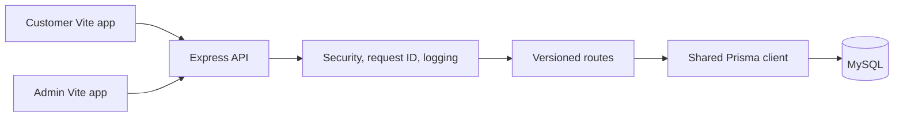
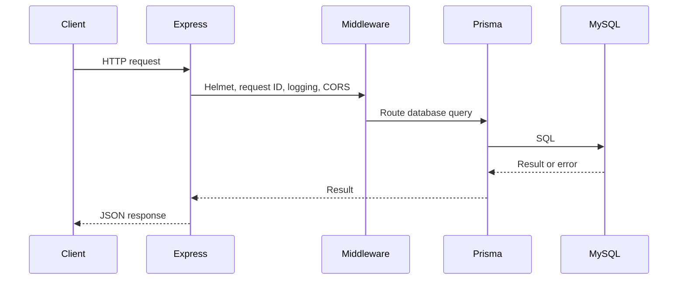
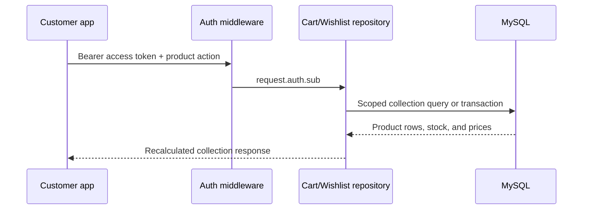

# Phase 2 architecture

The pnpm workspace keeps the customer app, admin app, API, and shared contracts
independently buildable while allowing local workspace dependencies.

## API request lifecycle

Unknown routes and errors flow through the centralized error handler, which
returns safe structured responses and a correlation ID. The health endpoint
performs a lightweight database query and returns `503 DATABASE_UNAVAILABLE`
when Prisma cannot initialize.

## Cart and wishlist flow

Cart and wishlist routes are mounted under `/api/v1` and require the access
token issued by authentication. The authenticated subject is the only owner
identifier accepted by the repositories; clients cannot provide a different
customer ID.

Cart totals use current database prices and quantities. Composite unique keys
make adding an existing product idempotent instead of creating duplicate rows.

## Admin management flow

The admin app uses the same session mechanism, but administrative routes add a
server-side `ADMIN` role check. Product, category, customer, and inventory
queries use selective fields and database pagination. Password hashes and
refresh-token records are never selected for customer management responses.
For a file-by-file explanation of the current implementation and its actual
customer/admin workflows, see [codebase-learning-guide.md](./codebase-learning-guide.md).
