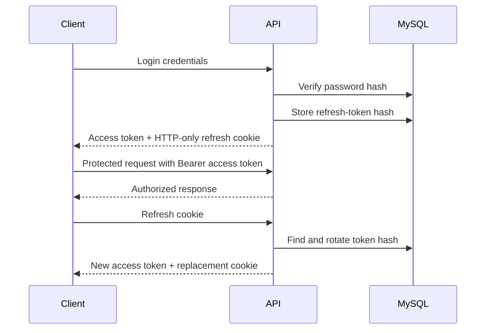

# Authentication foundation

The API authentication slice uses short-lived JWT access tokens and rotated
refresh tokens. Access tokens are returned to the frontend for the
`Authorization: Bearer` header. Refresh tokens are stored only as SHA-256
hashes in MySQL and delivered through an HTTP-only cookie scoped to
`/api/v1/auth`.

## Endpoints

- `POST /api/v1/auth/register`
- `POST /api/v1/auth/login`
- `POST /api/v1/auth/refresh`
- `POST /api/v1/auth/logout`
- `POST /api/v1/auth/logout-all`
- `GET /api/v1/auth/me`
- `GET /api/v1/auth/sessions`
- `DELETE /api/v1/auth/sessions/:sessionId`
- `GET /api/v1/auth/customer/profile`
- `GET /api/v1/auth/admin/dashboard`

Public registration always creates a `CUSTOMER`. The admin role is only
available through the explicitly configured seed credentials.

Refresh-token reuse revokes all active sessions for the affected user. The
backend remains the security boundary; frontend route guards are only a UX
optimization.
